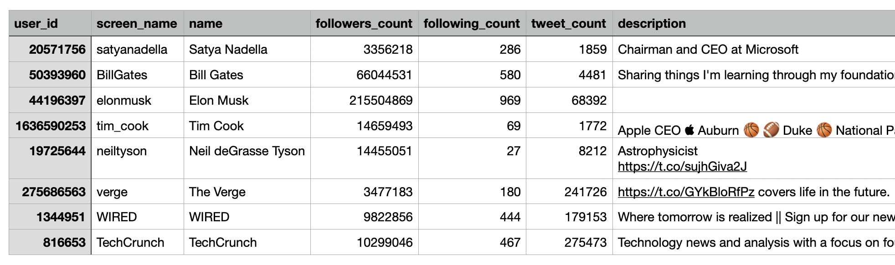
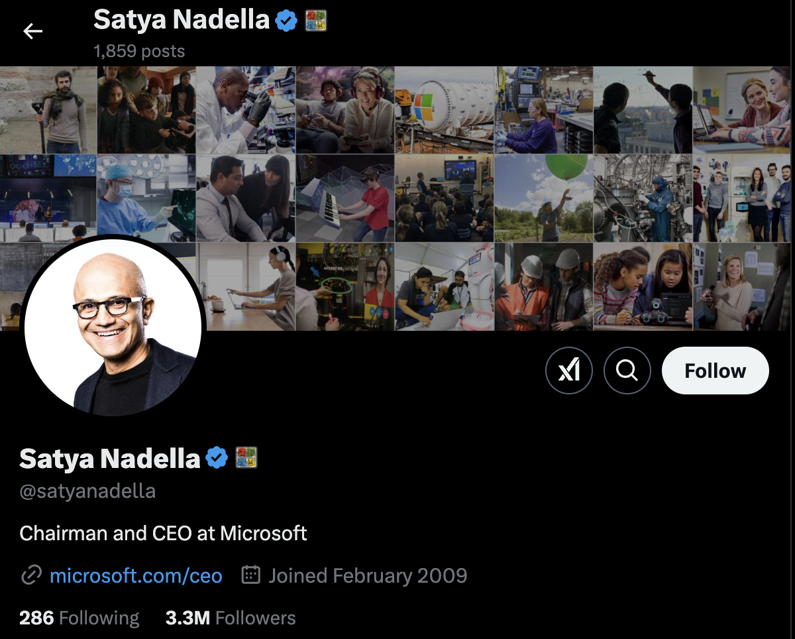

# Twitter（X）数据爬虫 — 由 Bright Data 提供

[](https://brightdata.com/products/web-scraper/twitter)

本仓库提供两种收集 Twitter 数据的方法：
1. 免费 Twitter 爬虫：适用于小型项目与学习
2. [企业级 Twitter 爬虫 API](https://www.bright.cn/products/web-scraper/twitter)：适用于生产级数据采集

## 目录
1. [免费 Twitter 爬虫](#免费-twitter-爬虫)
    - [个人资料抓取](#1-个人资料抓取)
    - [推文抓取](#2-推文抓取)
    - [限制](#限制)
2. [Twitter 爬虫 API](#twitter-爬虫-api)
    - [主要特性](#主要特性)
    - [快速开始指南](#快速开始指南)
    - [按 URL 抓取推文](#1-按-url-抓取推文)
    - [抓取个人资料数据](#2-抓取个人资料数据)
    - [按日期范围采集推文](#3-按日期范围采集推文)
3. [无代码爬虫选项](#无代码爬虫选项)
4. [数据采集方式](#数据采集方式)
5. [支持与资源](#支持与资源)


## 免费 Twitter 爬虫
适合小规模项目、实验与学习用途。

### 1. 个人资料抓取
提取 Twitter 公开个人资料数据，包括姓名、粉丝数、推文数等。

#### 输入要求：
| 参数       | 类型 | 必填 | 描述                           |
|------------|------|------|--------------------------------|
| usernames  | list | 是   | 要抓取的 Twitter 账号列表       |

#### 实现：
```python
# free_scraper/twitter_profiles.py
usernames = [
    "satyanadella",
    "BillGates", 
    "elonmusk"
]
```

#### 示例输出（CSV）：


### 2. 推文抓取
收集指定推文的互动指标。

#### 输入要求：

| 参数       | 类型 | 必填 | 描述                       |
|------------|------|------|----------------------------|
| tweet_ids  | list | 是   | 要抓取的 Twitter 推文 ID 列表 |

#### 实现：
```python
# free_scraper/twitter_posts.py
TWEET_IDS = [
    "1882412972414214544",
    "1879604491764297992",
    "1869427646368792599"
]
```

#### 示例输出（JSON）：
```json
{
  "tweet_id": "1882412972414214544",
  "author": "MongoDB",
  "content": "We're excited to announce...",
  "engagement": {
    "likes": 29,
    "retweets": 10,
    "views": 3417
  }
}
```

### 限制
由于 Twitter 严格的反爬策略，免费方案不适合大规模抓取。主要限制包括：
- 速率限制：抓取数次后即可能被限流
- IP 封禁：同一 IP 频繁抓取可能被封禁
- 可扩展性有限：不适合高并发/高量数据采集
- 字段受限：仅提供基础资料与推文数据，无高级筛选

## Twitter 爬虫 API
面向大规模 Twitter 数据采集的高可靠、可扩展解决方案。为需要高质量、实时数据且不想自建运维的企业与开发者设计。

### 主要特性
- 可扩展与高可靠：为高并发与实时采集优化
- 反封锁：内置[代理轮换](https://www.bright.cn/solutions/rotating-proxies)与[验证码自动识别](https://www.bright.cn/products/web-unlocker/captcha-solver)
- 合规：全面符合 GDPR 与 CCPA
- 全球覆盖：支持任意地区与语言的数据访问
- 实时数据：低延迟的最新数据
- 高级过滤：可用精细筛选定制采集
- 按使用量付费：仅为成功响应付费
- 免费试用：含 20 次免费 API 调用
- 专属支持：7x24 小时技术支持

👉 了解更多：[Bright Data Twitter 爬虫 API](https://www.bright.cn/products/web-scraper/twitter)

### 快速开始指南
- 注册：创建 [Bright Data 账户](https://www.bright.cn/)
- 获取 API Token：在控制台获取 [API Key](https://docs.brightdata.com/general/account/api-token)
- 选择 Endpoint：从下列可用 API 端点中选择

### 1. 按 URL 抓取推文
通过推文 URL 提取详细内容与互动指标。


#### 请求参数：
| 字段  | 类型   | 必填 | 描述                 |
|-------|--------|------|----------------------|
| `url` | string | 是   | 推文的完整 URL       |

#### 示例请求：
```python
# twitter_api/twitter_posts.py
posts = [
    {"url": "https://x.com/OpenAI/status/1885406586136383634"},
    {"url": "https://x.com/CNN/status/1796673270344810776"}
]
```

#### 响应结构：
```json
{
    "post": {
        "author": {
            "name": "OpenAI",
            "followers": 3930255,
            "profileImage": "https://pbs.twimg.com/profile_images/1885410181409820672/ztsaR0JW_normal.jpg",
            "bio": "OpenAI's mission is to ensure that artificial general intelligence benefits all of humanity. We're hiring: https://t.co/dJGr6Lg202",
        },
        "content": {
            "text": "OpenAI o3-mini is now available in ChatGPT and the API.\n\nPro users will have unlimited access to o3-mini and Plus & Team users will have triple the rate limits (vs o1-mini).\n\nFree users can try o3-mini in ChatGPT by selecting the Reason button under the message composer.",
            "postedAt": "2025-01-31T19:15:33.000Z",
            "id": "1885406586136383634",
        },
        "engagement": {
            "replies": 1004,
            "reposts": 1997,
            "likes": 13420,
            "views": 2858777,
            "quotes": 684,
            "bookmarks": 1546,
        },
    }
}
```
👉 此处仅展示关键字段。查看[完整 JSON 响应](https://github.com/bright-cn/Twitter-Scraper/blob/main/twitter_data/twitter_posts.json)获取全部细节。立即试用我们的[推文抓取器](https://www.bright.cn/products/web-scraper/twitter/posts)。

### 2. 抓取个人资料数据
提取全面的个人资料信息，包括近期推文与互动指标。



#### 请求参数：

| 字段                   | 类型   | 必填 | 描述                     |
|------------------------|--------|------|--------------------------|
| `url`                  | string | 是   | Twitter 个人资料页面 URL |
| `max_number_of_posts`  | number | 否   | 要返回的最近推文数量     |

#### 示例请求：
```python
# twitter_api/twitter_profile_posts.py
profiles = [
    {"url": "https://x.com/satyanadella", "max_number_of_posts": 50},
    {"url": "https://x.com/BillGates", "max_number_of_posts": 35}
]
```

#### 响应结构：
```json
{
    "profile": {
        "name": "Satya Nadella",
        "handle": "satyanadella",
        "role": "Chairman and CEO at Microsoft",
        "isVerified": true,
        "profileImage": "https://pbs.twimg.com/profile_images/1221837516816306177/_Ld4un5A_normal.jpg",
        "website": "http://www.microsoft.com/ceo",
        "joinedDate": "2009-02-11T04:45:34.000Z",
        "stats": {"following": 286, "followers": 3356268, "postsCount": 1859},
    },
    "posts": [
        {
            "id": "1807114709499523208",
            "content": "What a final!!! Congrats, India, and well played, South Africa. Super World Cup... let us have more cricket in the West Indies and USA!!",
            "postedAt": "2024-06-29T18:11:35.000Z",
            "engagement": {
                "replies": 712,
                "reposts": 10785,
                "likes": 133591,
                "views": 2029775,
            },
        },
        {
            "id": "1726509045803336122",
            "content": "We remain committed to our partnership with OpenAI and have confidence in our product roadmap, our ability to continue to innovate with everything we announced at Microsoft Ignite, and in continuing to support our customers and partners. We look forward to getting to know Emmett",
            "postedAt": "2023-11-20T07:53:28.000Z",
            "engagement": {
                "replies": 4524,
                "reposts": 14480,
                "likes": 89773,
                "views": 41675720,
            }
        },
    ],
}
```
👉 此处仅展示关键字段。查看[完整 JSON 响应](https://github.com/bright-cn/Twitter-Scraper/blob/main/twitter_data/twitter_profile_posts.json)获取全部细节。立即试用我们的[个人资料抓取器](https://www.bright.cn/products/web-scraper/twitter/profile)。

### 3. 按日期范围采集推文
在指定日期范围内检索推文。

#### 请求参数：

| 参数          | 类型   | 必填 | 描述                         |
|---------------|--------|------|------------------------------|
| `url`         | string | 是   | Twitter 个人资料页面 URL     |
| `start_date`  | string | 是   | 起始日期（ISO 格式）          |
| `end_date`    | string | 是   | 结束日期（ISO 格式）          |


#### 示例请求：
```python
# twitter_api/twitter_posts_date_range.py
profiles = [
    {
        "url": "https://x.com/satyanadella",
        "start_date": "2025-01-15T09:00:00.000Z",
        "end_date": "2025-01-31T23:00:00.000Z",
    },
    {"url": "https://x.com/cnn", "start_date": "2025-01-01", "end_date": "2025-01-15"},
    {"url": "https://x.com/fabrizioromano", "start_date": "", "end_date": ""},
]
```

#### 响应结构：
```json
{
    "post": {
        "author": {
            "name": "Satya Nadella",
            "handle": "satyanadella",
            "role": "Chairman and CEO at Microsoft",
            "isVerified": false,
            "profileImage": "https://pbs.twimg.com/profile_images/1221837516816306177/_Ld4un5A_normal.jpg",
            "followers": 3356282,
            "following": 286,
        },
        "content": {
            "text": "For me, cricket is maybe the only thing that could possibly come close to watching the Excel World Champ on ESPN!",
            "images": ["https://pbs.twimg.com/media/GiF4nePaEAAHQg5.jpg"],
            "externalUrl": "https://techcommunity.microsoft.com/blog/excelblog/congrats-to-the-winners-of-this-years-mewc--mecc/4355651",
            "postedAt": "2025-01-24T22:29:46.000Z",
            "id": "1882918743409676719",
        },
        "engagement": {
            "replies": 102,
            "reposts": 208,
            "likes": 3416,
            "views": 286901,
            "quotes": 39,
            "bookmarks": 127,
        },
    }
}
```
👉 此处仅展示关键字段。查看[完整 JSON 响应](https://github.com/bright-cn/Twitter-Scraper/blob/main/twitter_data/twitter_date_range_posts.json)获取全部细节。

## 无代码爬虫选项
若偏好图形化操作界面，我们也提供控制台中的无代码方案：

- 数分钟内完成配置
- 全流程自动化数据采集
- 结果直接下载（多种格式）

详细使用说明请参阅我们的[快速上手指南](https://github.com/bright-cn/Twitter-Scraper/blob/main/no-code-scraper.md)。

## 数据采集方式
可使用以下参数微调结果：
| 参数                 | 类型      | 描述                                              | 示例                            |
|----------------------|-----------|---------------------------------------------------|---------------------------------|
| `limit`              | `integer` | 每个输入的最大返回结果数                          | `limit=10`                      |
| `include_errors`     | `boolean` | 返回错误报告以便排查                              | `include_errors=true`           |
| `notify`             | `url`     | 任务完成后的 Webhook 通知地址                      | `notify=https://notify-me.com/` |
| `format`             | `enum`    | 输出格式（如 JSON、NDJSON、JSONL、CSV）           | `format=json`                   |

💡 提示：你还可以选择将数据[投递到外部存储](https://docs.brightdata.com/scraping-automation/web-data-apis/web-scraper-api/overview#via-deliver-to-external-storage)或[投递到 Webhook](https://docs.brightdata.com/scraping-automation/web-data-apis/web-scraper-api/overview#via-webhook)。

## 支持与资源
- API 文档：[Bright Data 文档](https://docs.brightdata.com/scraping-automation/web-data-apis/trigger-a-collection)
- 抓取最佳实践：[避免被封锁](https://www.bright.cn/blog/web-data/web-scraping-without-getting-blocked)
- 技术支持：[联系我们](mailto:support@brightdata.com)

---

对其他爬虫感兴趣？请查看下列列表：

- [LinkedIn 爬虫](https://github.com/bright-cn/LinkedIn-Scraper)
- [Google 新闻爬虫](https://github.com/bright-cn/Google-News-Scraper)
- [Google 地图爬虫](https://github.com/bright-cn/Google-Maps-Scraper)
- [Amazon 爬虫](https://github.com/bright-cn/Amazon-scraper)
